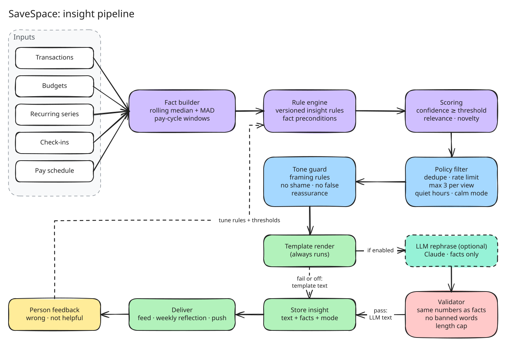
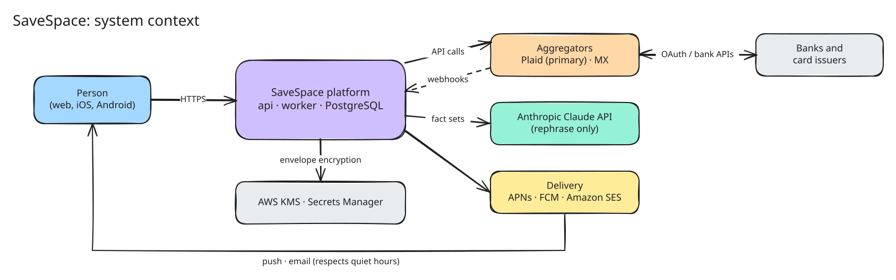
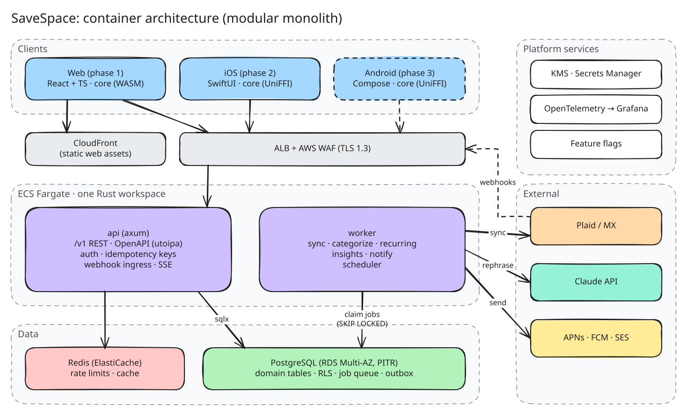
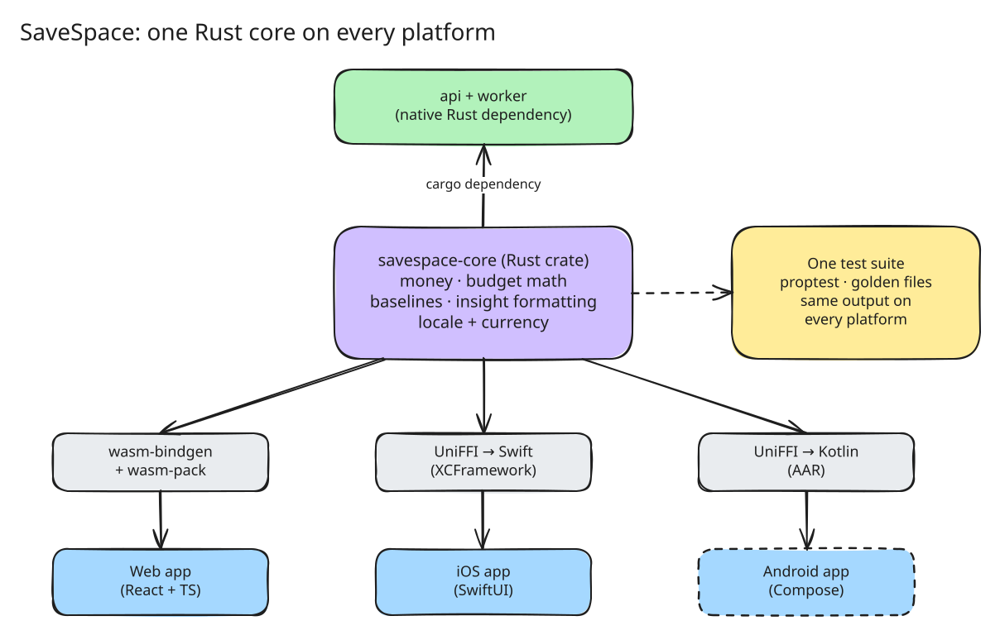
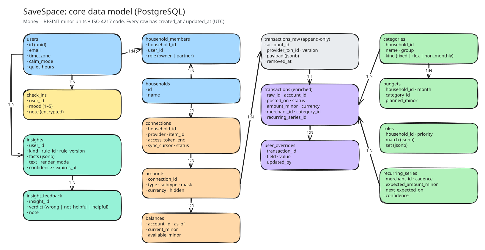
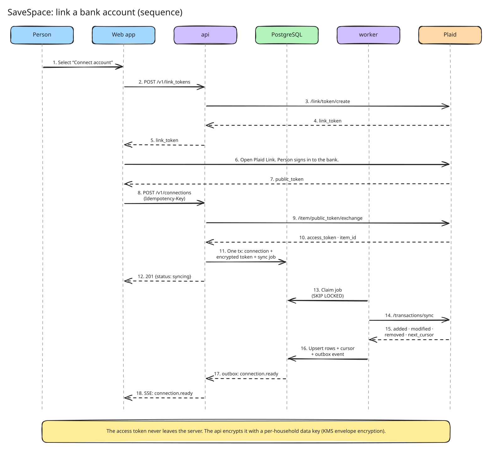
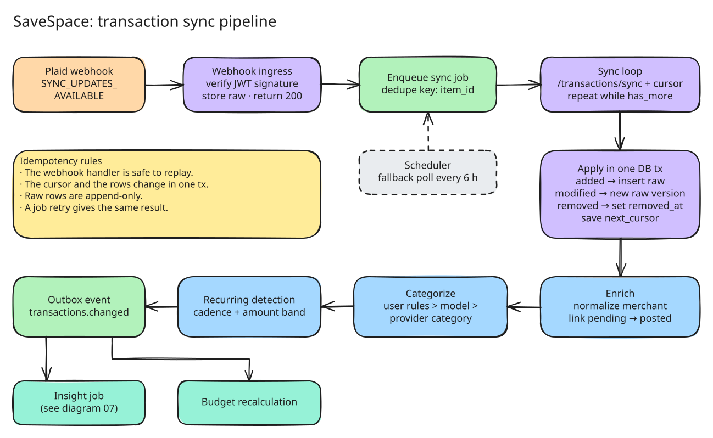

# SaveSpace: design document

| Field | Value |
| --- | --- |
| Status | Draft |
| Version | 0.1 |
| Date | 2026-11-04 |
| Owner | srrfrhmn |
| Reviewers | Engineering, Product, Design, Security, Legal, a licensed financial therapist |
| Decision log | [Section 18](#18-decision-log) |

Read [Appendix A](#appendix-a-writing-conventions) before you edit this document. This document uses ASD-STE100-inspired rules.

---

## Contents

1. [Summary](#1-summary)
2. [Problem](#2-problem)
3. [Goals and non-goals](#3-goals-and-non-goals)
4. [Users and product principles](#4-users-and-product-principles)
5. [Behavioral foundations](#5-behavioral-foundations)
6. [Product scope](#6-product-scope)
7. [Insight system](#7-insight-system)
8. [Architecture](#8-architecture)
9. [Data model](#9-data-model)
10. [Key flows](#10-key-flows)
11. [API design](#11-api-design)
12. [Security, privacy, and compliance](#12-security-privacy-and-compliance)
13. [Reliability and operations](#13-reliability-and-operations)
14. [Engineering practices](#14-engineering-practices)
15. [Metrics](#15-metrics)
16. [Roadmap](#16-roadmap)
17. [Risks and open questions](#17-risks-and-open-questions)
18. [Decision log](#18-decision-log)
19. [Glossary](#19-glossary)
- [Appendix A: writing conventions](#appendix-a-writing-conventions)
- [Appendix B: insight copy style guide](#appendix-b-insight-copy-style-guide)
- [Appendix C: references](#appendix-c-references)

---

## 1. Summary

SaveSpace is a personal finance app. It connects to the bank accounts of a person and reads their transactions. It does not move money.

Most finance apps show raw numbers. Raw numbers without context can cause anxiety. SaveSpace converts numbers into short, true, calm statements. We call these statements **insights**. Examples:

- "You spent less than usual this week."
- "You are on track for your monthly budget."
- "This charge is recurring and expected."

Deterministic rules calculate every fact and number in an insight. A large language model (LLM) can rephrase the text. The LLM cannot add or change a number. A validator checks every LLM output. If the check fails, SaveSpace shows the template text.

The product design uses methods from financial therapy, behavioral psychology, and behavioral economics. Section 5 maps each method to a feature and to a guardrail.

The backend is a Rust modular monolith on AWS. One Rust crate (`savespace-core`) holds all money and budget math. The web app, the iOS app, and the Android app use this crate. The web app ships first. iOS (Swift) ships second. Android ships third.

---

## 2. Problem

Money is a main source of stress for many adults. Stress about money has these effects:

- **Avoidance.** Some people do not open their bank app for weeks. They miss fees and errors. This is the "ostrich effect".
- **Over-checking.** Some people check their balance many times each day. Each check gives a short relief, then more anxiety.
- **Reduced mental bandwidth.** Scarcity and worry decrease the capacity for good decisions.

Current tools have these problems:

| Problem | Example |
| --- | --- |
| Numbers without context | "$412.18 spent" does not tell the person if that is normal. |
| Comparison to the wrong anchor | Comparison to population averages causes shame or false comfort. |
| Alarm-style alerts | Red badges and "Overspent!" banners cause stress for small, expected variance. |
| Unexplained surprises | A recurring charge looks like a new charge. |
| Engagement design | Streaks and variable rewards increase app use, not well-being. |

SaveSpace solves the problem of context. It tells the person what is normal **for them**, what is expected, and what needs attention.

---

## 3. Goals and non-goals

### 3.1 Goals

| ID | Goal | Measure (see Section 15) |
| --- | --- | --- |
| G1 | Decrease the financial anxiety of the person. | Change in CFPB Financial Well-Being Scale score and in-app check-in score. |
| G2 | Show only correct insights. | Insight correctness rate ≥ 99.5%. |
| G3 | Explain every number. | 100% of insights have a "Why am I seeing this?" view with source facts. |
| G4 | Earn trust with security and privacy. | Zero data breaches. SOC 2 Type II report by end of Phase 3. |
| G5 | Be fast. | Web p75 LCP < 2.0 s. API p99 read latency < 300 ms. |

### 3.2 Non-goals (v1)

- Money movement (payments, transfers, bill pay).
- Bank accounts or cards from SaveSpace (Banking-as-a-Service). Section 16 includes a later evaluation.
- Credit products, loans, or credit score.
- Investment advice, tax advice, or legal advice.
- Clinical therapy. SaveSpace is not a medical or mental health service.
- Social features (public comparison, leaderboards).

---

## 4. Users and product principles

### 4.1 Personas

| Persona | Behavior | Need | SaveSpace response |
| --- | --- | --- | --- |
| **The avoider** | Does not open bank apps. Feels dread. | A safe way to look. | Calm mode. One weekly reflection. Gentle exposure. |
| **The over-checker** | Checks balances many times each day. | Confidence that things are normal. | "Expected" labels. Personal baselines. Few notifications. |
| **The couple** | Two people share some accounts. Money causes conflict. | One shared, neutral view. | Shared household. Neutral language. No blame for spend by person. |

### 4.2 Product principles

Use these principles to make product decisions. If two principles conflict, the principle that is higher in the list wins.

1. **Truth before comfort.** Never show false reassurance. A calm tone must not hide a real problem.
2. **Explain every number.** Every insight links to the facts that produced it.
3. **No shame.** Do not use blame, guilt, or moral words about spend.
4. **The person is in control.** The person can change, mute, or delete every insight type and notification.
5. **Calm by default.** Show the minimum information that answers the question "Am I okay?". Show details on request.
6. **Fast and quiet.** The app opens fast. It does not ask for attention without a reason.

---

## 5. Behavioral foundations

### 5.1 Technique map

Each row maps a technique to a feature and a guardrail. A licensed financial therapist reviews this table before each phase.

| Technique | Source | Feature | Guardrail |
| --- | --- | --- | --- |
| **Money scripts** | Klontz et al. (2011) | Optional onboarding reflection. The person selects statements that match their beliefs (avoidance, worship, status, vigilance). The result changes insight order and tone. | Never label the person. Never show a "type" as a diagnosis. The person can skip or reset it. |
| **Values-based spending** | Financial therapy practice | The person marks categories as "important to me". Insights frame spend in these categories as aligned with values. | Do not judge categories that are not marked. |
| **Self-compassion framing** | Neff (2003) | Concern insights use neutral, kind words. "Dining was higher this month. That happens." | No "you should", "bad", "overspent", or "failed". |
| **Motivational interviewing** | Miller and Rollnick | Suggestions ask, they do not tell. "Do you want to set a dining amount for next month?" | The person can decline. Declined suggestions do not repeat for 30 days. |
| **Gentle exposure** (counter to ostrich effect) | Karlsson, Loewenstein, Seppi (2009) | Weekly reflection: a short, fixed-length summary. Calm mode hides exact balances until the person taps. | Never hide information that needs action (for example, a projected overdraft). |
| **Uncertainty reduction** | Anxiety research: uncertainty increases threat response | "Expected" label on recurring charges. Upcoming recurring charges list. | Show "expected" only when the match confidence is above threshold (Section 7.4). |
| **Cognitive load limits** | Mullainathan and Shafir (2013) | Max 3 insights per view. One primary insight on the home screen. | Concerns that need action always take a slot. |
| **Implementation intentions** | Gollwitzer (1999) | Optional "if-then" plans. "If dining passes $300, then show me one note." | The person writes the plan. SaveSpace does not create plans for the person. |
| **Peak-end rule** | Kahneman et al. (1993) | The weekly reflection ends with a positive, true fact. | If no positive true fact exists, end with a neutral fact. Never invent one. |
| **Fresh-start effect** | Dai, Milkman, Riis (2014) | Offer goal and budget resets at natural start points (new month, payday, birthday). | Offer only. Do not push. |
| **Personal baseline anchoring** | Tversky and Kahneman (1974) | All comparisons use the person's own history (median), not population data. | Require minimum history (Section 7.3). |
| **Mental accounting** | Thaler (1999) | Flex budget: fixed, flexible, and non-monthly buckets. Non-monthly costs are spread across months. | Do not show non-monthly costs as "over budget" in the month they post. |
| **Loss-aversion-aware framing** | Kahneman and Tversky (1979) | Frame progress as "kept" or "left" ("$140 left for dining"), not as "lost". | Numbers must stay exact. Framing must not change meaning. |
| **Defaults** | Madrian and Shea (2001) | Defaults: quiet hours on (21:00–08:00 local), one notification per day max, calm mode available at onboarding. | All defaults protect the person. No default increases engagement at the cost of well-being. |
| **Pain of paying** | Prelec and Loewenstein (1998) | No feature. We do not add friction to spend. | SaveSpace does not try to decrease spend in general. It supports the plan of the person. |
| **Present bias** | Laibson (1997) | Goal progress shows near-term milestones. | Milestones are real. No fake progress. |

### 5.2 Banned patterns

The product MUST NOT use these patterns. Design review rejects any feature that uses them.

| Pattern | Reason |
| --- | --- |
| Streaks with loss ("Do not break your streak!") | Creates guilt. Rewards app use, not well-being. |
| Variable-ratio rewards (random badges, surprise points) | Creates compulsive checking. |
| Red badge counts for non-urgent items | Creates false urgency. |
| Countdown timers and fake scarcity | Creates pressure. |
| Population comparison ("You spend more than 80% of users") | Creates shame or false comfort. |
| Confirmshaming ("No, I do not care about my money") | Manipulative. |
| Notifications whose only purpose is to bring the person back | Increases anxiety. |
| Insight text with exclamation marks or all-caps | Reads as alarm. |

### 5.3 Clinical boundary

SaveSpace is not therapy. These rules apply:

- The app shows a clear "not a medical service" statement in Settings and in onboarding.
- Check-in notes are private. SaveSpace does not send check-in notes to an LLM. SaveSpace does not analyze note text.
- The help page lists links to financial counseling (NFCC) and to the 988 Suicide and Crisis Lifeline (US).
- A licensed financial therapist reviews the insight copy library before each release that changes it.

---

## 6. Product scope

### 6.1 Phase 1 (web MVP)

| Feature | Description |
| --- | --- |
| Account connection | Connect bank and card accounts through Plaid. Show connection health. |
| Transactions | List, search, filter. Edit category, merchant, note. Split a transaction. Hide a transaction. |
| Categorization | Automatic category. Person-defined rules ("Always set Trader Joe's to Groceries"). |
| Recurring detection | Find recurring charges and income. Show the next expected date and amount. |
| Flex budget | Three buckets: fixed, flexible, non-monthly. Monthly plan. Rollover option per category. |
| Insights feed | Max 3 insights per view. Each insight has "Why am I seeing this?", "This is wrong", and "Not helpful". |
| Weekly reflection | A fixed-length weekly summary. Max 5 cards. Ends on a positive or neutral true fact. |
| Calm mode | Hide exact balances. Show a state ("Covered", "Tight", "Needs attention") with tap to reveal. |
| Money check-in | One question: "How do you feel about money today?" Scale 1–5. Optional note. |
| Notification settings | Channels, quiet hours, daily limit, per-insight-kind mute. |
| Data controls | Export all data (CSV and JSON). Delete account and all data. |

### 6.2 Later phases

| Phase | Features |
| --- | --- |
| 2 | iOS app (Swift). Push notifications. Goals. If-then plans. |
| 3 | Android app. Shared household (two members). MX as second aggregator. |
| 4 | Cash-flow forecast. Money scripts onboarding v2. BaaS evaluation (Section 16). |

---

## 7. Insight system

The insight system is the core of SaveSpace. This section is normative. Use MUST, SHOULD, and MAY as defined in RFC 2119.



Source: [`07-insight-pipeline.excalidraw`](diagrams/07-insight-pipeline.excalidraw)

### 7.1 Insight kinds

| Kind | Purpose | Example | Max per view |
| --- | --- | --- | --- |
| `reassurance` | Confirm that a thing is normal or on plan. | "You are on track for your monthly budget." | 2 |
| `awareness` | Report a change from the personal baseline. | "Dining was higher than usual this week." | 1 |
| `anticipation` | Report a known future event. | "Rent ($1,800) is expected on Dec 1." | 2 |
| `suggestion` | Offer an optional action. | "Do you want a rule for this merchant?" | 1 |
| `concern` | Report a condition that needs action. | "Your checking balance may not cover rent on Dec 1." | Always shown |

Total per view MUST NOT exceed 3, except for `concern` insights. A `concern` insight always takes a slot.

### 7.2 Pipeline

The worker runs the pipeline. Triggers:

- The outbox event `transactions.changed` (after a sync).
- A daily schedule at 06:00 in the time zone of the person.
- A weekly schedule for the weekly reflection.

Steps:

1. **Fact builder.** Read inputs. Calculate facts and baselines. Facts are typed values (amounts, dates, counts, ratios). Facts have a source (transaction IDs, budget ID).
2. **Rule engine.** Evaluate each insight rule against the facts. A rule has preconditions and an output kind. Rules are versioned (`rule_id`, `rule_version`).
3. **Scoring.** Calculate `confidence` (0–1) and `relevance` (0–1). Drop the candidate if `confidence` < rule threshold.
4. **Policy filter.** Apply dedupe (same rule, same scope, 7 days), rate limits, the max-per-view limit, quiet hours, calm mode, and person mutes.
5. **Tone guard.** Apply framing rules (Section 7.6). Apply the conflict rule: a `reassurance` insight MUST NOT appear if an open `concern` insight covers the same scope.
6. **Template render.** Always render the template text. The template text is the fallback.
7. **LLM rephrase (optional).** If enabled for the rule, send the fact set and template text to the LLM. See Section 7.5.
8. **Validator.** Check the LLM text. If it fails, use the template text.
9. **Store.** Write the insight with text, facts, `render_mode`, and rule version.
10. **Deliver.** Show in the feed, in the weekly reflection, or as a notification.

### 7.3 Baselines

All comparison insights use a personal baseline. Rules:

- Use **robust statistics**. Baseline = rolling median of the last N periods. Spread = median absolute deviation (MAD).
- Align periods to the pay cycle of the person if SaveSpace detects one. Else, use calendar weeks (Monday start, configurable).
- Compare like with like. "Week to date on Thursday" compares with "week to date on Thursday" in past weeks.
- Exclude transfers between own accounts, refunds matched to a purchase, and transactions the person hid.
- Require minimum history: 6 complete periods for weekly comparisons, 3 complete months for monthly comparisons.
- If history is below the minimum, do not show a comparison insight. Show an onboarding message: "SaveSpace needs a few more weeks to learn what is normal for you."

### 7.4 Example rules

#### 7.4.1 `spend.week_below_usual` (kind: `reassurance`)

| Field | Value |
| --- | --- |
| Scope | Flexible spend, week to date. |
| Facts | `wtd_spend_minor`, `baseline_median_minor`, `baseline_mad_minor`, `weeks_of_history`. |
| Precondition | `weeks_of_history ≥ 6` AND `wtd_spend ≤ baseline_median − max(1.0 × MAD, 5% of median, $10)`. |
| Confidence | Increases with history length and with distance below the median. |
| Template | "You spent less than usual this week: {wtd_spend} so far, compared to a usual {baseline_median}." |

#### 7.4.2 `budget.month_on_track` (kind: `reassurance`)

| Field | Value |
| --- | --- |
| Scope | Flexible budget, month to date. |
| Facts | `mtd_flex_spend_minor`, `flex_plan_minor`, `expected_mtd_minor`, `days_left`. |
| Expected spend | Use the cumulative spend curve of the person by day of month (median of last 3 months). Fallback: linear pace. |
| Precondition | `mtd_flex_spend ≤ expected_mtd × 1.05` AND no open `concern` for the budget. |
| Template | "You are on track for your monthly budget. {flex_left} left for {days_left} days." |

#### 7.4.3 `txn.recurring_expected` (kind: `reassurance`, attached to a transaction)

| Field | Value |
| --- | --- |
| Scope | One transaction. |
| Facts | `series_id`, `expected_amount_minor`, `actual_amount_minor`, `expected_date`, `actual_date`, `cadence`. |
| Precondition | Transaction matches a recurring series. Amount within ±10% (or ±2 × MAD for variable bills). Date within ±3 days (monthly cadence). Series confidence ≥ 0.8. |
| Template | "This charge is recurring and expected. {merchant} charges about {expected_amount} each {cadence}." |
| Variant | If the amount is outside the band, emit `awareness` instead: "This {merchant} charge is {delta} higher than usual." |

#### 7.4.4 Rule definition in code

Rules are Rust code, not a DSL. Rust code gives type checks, unit tests, and code review. The rule registry is versioned.

```rust
/// One rule produces zero or one candidate insight for one scope.
pub trait InsightRule: Send + Sync {
    fn id(&self) -> RuleId;          // "spend.week_below_usual"
    fn version(&self) -> u16;        // increment on any logic change
    fn kind(&self) -> InsightKind;   // Reassurance, Awareness, ...
    fn evaluate(&self, facts: &FactSet) -> Option<Candidate>;
}

pub struct Candidate {
    pub scope: Scope,                // e.g. Scope::FlexSpend { week: IsoWeek }
    pub facts: Vec<Fact>,            // only the facts the text may use
    pub confidence: Confidence,      // newtype, 0.0..=1.0
    pub relevance: Relevance,
    pub template: TemplateId,
}

pub enum Fact {
    Money { key: &'static str, value: Money },     // Money = i64 minor units + Currency
    Date  { key: &'static str, value: jiff::civil::Date },
    Count { key: &'static str, value: u32 },
    Ratio { key: &'static str, value: BasisPoints },
}
```

### 7.5 LLM rephrase

The LLM makes the text feel natural and varied. The LLM is not a source of truth.

**Input.** The worker sends only:

- The template text.
- The fact set (keys and formatted values).
- The insight kind and tone rules.
- The locale.

The worker MUST NOT send account numbers, balances that are not in the fact set, check-in notes, names of people, or raw transaction lists.

**Sensitive categories.** If the scope includes a sensitive category (health, medical, legal, gambling, dating, religious giving), the worker MUST use the template text. It MUST NOT call the LLM.

**Model and placement.** Use a small, fast Claude model (for example `claude-haiku-5-5`). The call happens in the worker at generation time. It never happens on the request path of the app. Cache the result by `hash(rule_id, rule_version, facts, locale, prompt_version)`.

**Validator.** The validator MUST reject the LLM text if any check fails:

| Check | Rule |
| --- | --- |
| Number integrity | Extract every number, amount, percent, and date from the text. The multiset MUST equal the multiset of formatted fact values the template uses. No new numbers. No missing numbers. |
| Number words | Reject number words ("twenty", "half", "double") and relative words that imply a number ("most", "nearly all"). |
| Banned words | Reject any word in the banned list (Appendix B). |
| Kind consistency | A `reassurance` text MUST NOT contain concern words. A `concern` text MUST NOT contain reassurance words. |
| Length | Max 140 characters for feed text. Max 1 sentence for notifications. |
| Format | Plain text. No emoji. No exclamation marks. No markdown. |

**Logs.** Store the template text, the LLM text, the validator result, and the `prompt_version` for each insight. Sample 1% of LLM texts each week for human review.

**Evaluation.** Keep an offline set of at least 500 fact sets with expected properties. Run it in CI when the prompt, the model, or a template changes. The release gate has three conditions:

- The validator pass rate is ≥ 98%.
- A second, independent parser finds zero number-integrity failures in texts that passed the validator.
- The human rubric score (calm, correct, clear) is ≥ 4.5 / 5 on a 50-item sample.

### 7.6 Tone rules

- Lead with the fact, then the context. "You spent $212 this week. That is less than usual."
- Use "usual" and "expected". Do not use "average" (it suggests a population).
- Use "higher than usual", not "overspent".
- Use "left", not "remaining budget" or "lost".
- For `concern`: state the fact, the date, and one optional action. Do not use alarm words.
- Never say "Do not worry". The person decides how to feel.

See Appendix B for the full style guide.

### 7.7 Feedback loop

Every insight has two controls: **"This is wrong"** and **"Not helpful"**.

- "This is wrong" opens a short form (wrong amount, wrong merchant, wrong category, other). SaveSpace hides the insight immediately. The event goes to an on-call review queue.
- "Not helpful" decreases the relevance of the rule for this person. Three "Not helpful" events for one rule in 30 days mute that rule for the person. The person can unmute it.
- The insights team reviews rule metrics each week: correctness rate, "Not helpful" rate, and view-to-dismiss rate per rule version.

---

## 8. Architecture

### 8.1 System context



Source: [`01-system-context.excalidraw`](diagrams/01-system-context.excalidraw)

| External system | Purpose | Data sent |
| --- | --- | --- |
| Plaid (primary aggregator) | Account connection, transactions, balances. | Link tokens, access tokens (server only). |
| MX (second aggregator, Phase 3) | Coverage for institutions with poor Plaid support. Failover. | Same as Plaid. |
| Anthropic Claude API | Insight rephrase. | Fact sets only (Section 7.5). |
| APNs, FCM, Amazon SES | Push and email delivery. | Notification text. No balances in push text by default. |
| AWS KMS, Secrets Manager | Key management and secrets. | Data keys. |

### 8.2 Containers



Source: [`02-architecture.excalidraw`](diagrams/02-architecture.excalidraw)

SaveSpace starts as a **modular monolith**. One Cargo workspace builds two binaries: `api` and `worker`. Domain logic lives in library crates. Crate boundaries are the future service boundaries. Do not split a crate into a network service until a measured need exists (independent scale, independent deploy, or team ownership).

| Container | Technology | Responsibility |
| --- | --- | --- |
| `api` | Rust, `axum`, `tower`, `tokio` | REST API, authentication, webhook ingress, server-sent events (SSE). Stateless. |
| `worker` | Rust, `tokio` | Job runner: sync, categorize, recurring detection, insights, notifications, scheduled jobs. |
| PostgreSQL | Amazon RDS, Multi-AZ, point-in-time recovery (PITR) | System of record. Job queue. Outbox. Row-level security (RLS). |
| Redis | Amazon ElastiCache | Rate limits. Short-lived cache. Not a source of truth. |
| Web app | React, TypeScript, `savespace-core` as WASM | Phase 1 client. |
| iOS app | Swift, SwiftUI, `savespace-core` through UniFFI | Phase 2 client. |
| Android app | Kotlin, Jetpack Compose, `savespace-core` through UniFFI | Phase 3 client. |

### 8.3 Rust crates

| Crate | Type | Responsibility |
| --- | --- | --- |
| `savespace-core` | lib (no I/O) | `Money`, currency, budget math, baselines, insight formatting. Compiles to native, WASM, and UniFFI. |
| `domain-identity` | lib | Users, households, sessions, passkeys. |
| `domain-ledger` | lib | Accounts, balances, transactions, overrides. |
| `domain-sync` | lib | Aggregator trait, sync logic, reconciliation. |
| `aggregator-plaid` / `aggregator-mx` | lib | Provider adapters that implement `Aggregator`. |
| `domain-categorize` | lib | Merchant normalization, rules, category model. |
| `domain-recurring` | lib | Recurring series detection. |
| `domain-insights` | lib | Fact builder, rule registry, policy, render, validator. |
| `domain-notify` | lib | Notification policy and delivery adapters. |
| `platform-db` | lib | `sqlx` pool, migrations, RLS session setup, outbox, job queue. |
| `platform-observability` | lib | `tracing`, OpenTelemetry export, PII scrubbing. |
| `api` | bin | HTTP layer only. Calls domain crates. |
| `worker` | bin | Job dispatch only. Calls domain crates. |

Dependency rule: `bin` → `domain-*` → `platform-*` → `savespace-core`. A domain crate MUST NOT depend on another domain crate's internals. Domain crates talk through public types and outbox events. `cargo deny` and a CI script enforce this rule.

### 8.4 Shared Rust core



Source: [`03-shared-core.excalidraw`](diagrams/03-shared-core.excalidraw)

`savespace-core` is the single source of truth for calculations. All clients and the server use it. This removes a common bug class: two platforms that calculate a different number for the same budget.

Rules for `savespace-core`:

- No I/O. No clock access (pass time in). No randomness. No global state.
- Money is `Money { minor: i64, currency: Currency }`. Arithmetic is checked. Overflow returns an error.
- No floating-point numbers for money. Ratios use basis points (`i32`).
- Locale formatting uses ICU4X.
- The public API is small and stable. UniFFI and `wasm-bindgen` expose the same functions.
- Golden-file tests run on every target (native, WASM in Node, iOS simulator, Android emulator). Every target MUST produce the same output.

### 8.5 Client technology

| Client | Stack | Reason |
| --- | --- | --- |
| Web | React 19, TypeScript, TanStack Router and Query, React Aria (accessible components), Vite with Rolldown, Biome (lint and format), Vitest, Playwright. | Large ecosystem. Mature accessibility libraries. Rust-based toolchain (Rolldown, Biome, oxc) gives fast builds. |
| iOS | Swift 6, SwiftUI, Swift Concurrency, Keychain, XCTest, XCUITest. | Native performance and platform conventions. |
| Android | Kotlin, Jetpack Compose, Coroutines, Android Keystore. | Native platform conventions. |

**Rejected: Leptos (Rust web UI).** Leptos gives one language for the full stack. We reject it for the web client because accessibility component libraries, design tools, and the hiring pool are much smaller. We get most of the Rust benefit from `savespace-core` in WASM.

**Performance budgets (web):**

| Budget | Limit |
| --- | --- |
| Initial JS (gzip) | 180 KB |
| `savespace-core` WASM (gzip) | 150 KB |
| p75 Largest Contentful Paint | 2.0 s |
| p75 Interaction to Next Paint | 200 ms |

CI fails if a pull request exceeds a budget.

### 8.6 Async work: job queue and outbox

Phase 1 uses PostgreSQL for async work. This keeps the number of moving parts low.

- **Job queue.** Table `jobs`. Workers claim jobs with `SELECT … FOR UPDATE SKIP LOCKED`. Each job has a `dedupe_key`, `run_after`, `attempts`, and `max_attempts`. Retries use exponential backoff with jitter. Jobs that exceed `max_attempts` go to a dead-letter state and page on-call if the kind is critical.
- **Transactional outbox.** A domain write and its event go in the same database transaction. A relay reads `outbox` rows in order and creates jobs or SSE messages.
- **Idempotency.** Every job handler is idempotent. A retry gives the same result.

**Trigger to change.** Move events to a log (for example, Redpanda or Kafka) when one of these conditions is true for 2 weeks:

- Job throughput is > 2,000 jobs/s.
- Queue lag p99 is > 60 s.
- A second team needs to consume events.

### 8.7 Infrastructure

| Area | Choice |
| --- | --- |
| Cloud | AWS, region `us-east-1`. Disaster recovery region `us-west-2`. |
| Compute | ECS on Fargate. One service each for `api` and `worker`. Auto scaling on CPU and queue depth. |
| Database | RDS PostgreSQL, Multi-AZ, PITR (35 days), encrypted with KMS. Read replica for analytics jobs. |
| Edge | CloudFront for static web assets. ALB with AWS WAF for the API. TLS 1.3. |
| IaC | Terraform. Every change through pull request and plan review. |
| Secrets | AWS Secrets Manager. No secrets in environment files or images. |
| Images | Distroless base images. Signed with Sigstore `cosign`. SBOM per build. |
| Environments | `dev`, `staging`, `prod`. Separate AWS accounts. Production data never goes to non-production. |

---

## 9. Data model



Source: [`04-data-model.excalidraw`](diagrams/04-data-model.excalidraw)

### 9.1 Data rules

| Rule | Detail |
| --- | --- |
| Money | `BIGINT` minor units plus `CHAR(3)` ISO 4217 code. Never `FLOAT`, never `NUMERIC` without currency. |
| IDs | UUIDv7 in the database. Prefixed IDs in the API (`txn_…`, `acct_…`, `ins_…`). |
| Time | `TIMESTAMPTZ` in UTC. Store the time zone of the person. Bucket days in the time zone of the person. Use `jiff` in Rust. |
| Dates | Transaction dates are `DATE` (bank calendar date), not timestamps. |
| Raw data | `transactions_raw` is append-only. A change from the provider adds a new version. A removal sets `removed_at`. |
| Person edits | `user_overrides` stores edits as an overlay. Never change raw data. The enriched view applies overrides last. |
| Tenancy | Every tenant table has `household_id`. RLS policies filter by `current_setting('app.household_id')`. |
| Encryption | Aggregator access tokens and check-in notes use field-level envelope encryption (Section 12.3). |
| Soft delete | Not used for personal data. Account deletion is a hard delete plus backup expiry (Section 12.5). |

### 9.2 Tables

| Table | Purpose |
| --- | --- |
| `users` | A person who signs in. Settings: time zone, calm mode, quiet hours. |
| `households` | A tenant. One or two members. |
| `household_members` | Join of users and households with a role. |
| `passkeys`, `sessions` | Authentication (Section 12.1). |
| `connections` | One aggregator item. Encrypted access token. Sync cursor. Status. |
| `accounts` | One bank or card account. Type, subtype, mask, currency. |
| `balances` | Balance time series. One row per account per sync. |
| `transactions_raw` | Provider payload, append-only, versioned. |
| `transactions` | Enriched transaction: merchant, category, recurring series, status. Derived from raw plus overrides. |
| `user_overrides` | Person edits to transactions. |
| `merchants` | Normalized merchants. |
| `categories` | Category tree with `kind` (fixed, flex, non_monthly). Per household. |
| `rules` | Person-defined categorization rules. JSONB match and set. Priority order. |
| `recurring_series` | Detected recurring charges and income. Cadence, expected amount, next date, confidence. |
| `budgets` | Monthly plan per category. |
| `insights` | Generated insights with facts, text, render mode, rule version. |
| `insight_feedback` | Person feedback on insights. |
| `check_ins` | Mood score and optional encrypted note. |
| `notifications` | Delivery records and status. |
| `jobs`, `outbox` | Async work (Section 8.6). |
| `idempotency_keys` | API idempotency store (Section 11.3). |
| `audit_log` | Security-relevant events. Append-only. |

### 9.3 Migrations

- Use `sqlx` migrations. Each migration is forward-only.
- Use the **expand and contract** pattern. Step 1: add the new column or table. Step 2: write to both. Step 3: backfill. Step 4: read from new. Step 5: remove old. Each step is a separate deploy.
- A migration MUST NOT take a lock longer than 2 seconds on a large table. Use `CREATE INDEX CONCURRENTLY`. CI runs migrations against a production-size snapshot (anonymized) each week.

---

## 10. Key flows

### 10.1 Connect a bank account



Source: [`05-account-link-sequence.excalidraw`](diagrams/05-account-link-sequence.excalidraw)

1. The person selects "Connect account".
2. The web app requests a link token from the API. The API requests it from Plaid.
3. The web app opens Plaid Link. The person signs in to the bank in Plaid Link. SaveSpace never sees bank credentials.
4. Plaid Link returns a `public_token` to the web app.
5. The web app sends the `public_token` to the API with an `Idempotency-Key` header.
6. The API exchanges the `public_token` for an `access_token`.
7. In one database transaction, the API stores the connection, the encrypted access token, and a sync job.
8. The API returns `201` with status `syncing`.
9. The worker claims the job and runs the initial sync.
10. The worker writes an outbox event. The API sends `connection.ready` to the web app through SSE.

During the first sync, the app shows a calm progress state. It does not show partial numbers.

### 10.2 Transaction sync



Source: [`06-transaction-sync.excalidraw`](diagrams/06-transaction-sync.excalidraw)

- **Triggers.** Plaid sends `SYNC_UPDATES_AVAILABLE` webhooks. A scheduler also polls each connection every 6 hours as a fallback.
- **Webhook ingress.** Verify the Plaid JWT signature and body hash. Store the raw webhook. Return `200` in less than 500 ms. Do no other work in the request.
- **Sync loop.** Call `/transactions/sync` with the stored cursor. Repeat while `has_more` is true. If Plaid returns a mutation error during pagination, restart from the last committed cursor.
- **Apply.** In one database transaction: insert added rows, add versions for modified rows, set `removed_at` for removed rows, and save `next_cursor`.
- **Pending to posted.** Link a posted transaction to its pending transaction with `pending_transaction_id`. Move person edits from the pending transaction to the posted transaction.
- **Enrich.** Normalize the merchant. Categorize in this order: person rules, then the category model, then the provider category.
- **Recurring detection.** Group by merchant. Detect cadence (weekly, biweekly, monthly, annual) and an amount band. Update `recurring_series`.
- **Events.** Write `transactions.changed` to the outbox. This starts the insight job and the budget recalculation.

### 10.3 Categorization model

- Input features: normalized merchant, MCC (if present), provider category, amount bucket, day of week, account type.
- Model: gradient-boosted trees, exported to ONNX, served in Rust with the `ort` crate. Inference runs in the worker.
- Training data: person-confirmed categories only (edits and confirmed rules), de-identified, with opt-out.
- Release gate: macro-F1 ≥ the current model on a fixed holdout set. Shadow mode for 7 days before rollout.

### 10.4 Notification delivery

- The worker evaluates the policy at send time, not at generation time.
- Policy: quiet hours (default 21:00–08:00 local), daily limit (default 1), per-kind mute, calm mode (no amounts in push text).
- If quiet hours block a notification, the worker delays it to the end of quiet hours. Notifications older than 24 hours expire, except `concern`.
- Push text never includes balances unless the person turns this on.

---

## 11. API design

### 11.1 Style

- REST over HTTPS. JSON bodies. `snake_case` fields.
- OpenAPI 3.1 generated from Rust types with `utoipa`. The spec is the contract.
- Generated clients: TypeScript (web), Swift (iOS), Kotlin (Android). CI fails if the generated clients are out of date.
- Resource IDs have a type prefix: `usr_`, `hh_`, `conn_`, `acct_`, `txn_`, `ins_`.

### 11.2 Versioning

- Use a date-based version header: `SaveSpace-Version: 2026-11-01`.
- The server pins each client build to a version. Breaking changes need a new version. A version gate layer converts responses to the older shape.
- Additive changes (new fields, new endpoints) do not need a new version. Clients MUST ignore unknown fields.

### 11.3 Idempotency

- Every `POST` that creates or changes state accepts an `Idempotency-Key` header.
- The server stores the key, a request hash, and the response for 24 hours.
- Same key, same request hash: return the stored response.
- Same key, different request hash: return `409 idempotency_key_reused`.

### 11.4 Errors

```json
{
  "error": {
    "type": "invalid_request_error",
    "code": "budget_month_invalid",
    "message": "The month must use the format YYYY-MM.",
    "param": "month",
    "request_id": "req_01JC8Z…"
  }
}
```

- `type` is one of: `invalid_request_error`, `authentication_error`, `permission_error`, `not_found_error`, `rate_limit_error`, `api_error`.
- Every response has a `Request-Id` header. Logs and traces use the same ID.

### 11.5 Pagination and streaming

- Cursor pagination: `limit`, `starting_after`, `ending_before`. Max `limit` is 100.
- SSE endpoint `/v1/events` for live updates (sync status, new insights). Clients fall back to polling.

### 11.6 Example endpoints (Phase 1)

| Method | Path | Purpose |
| --- | --- | --- |
| `POST` | `/v1/link_tokens` | Create a Plaid link token. |
| `POST` | `/v1/connections` | Exchange a public token. Create a connection. |
| `GET` | `/v1/accounts` | List accounts. |
| `GET` | `/v1/transactions` | List transactions. Filters: account, category, date range, search. |
| `PATCH` | `/v1/transactions/{id}` | Edit category, merchant, note, hidden. |
| `POST` | `/v1/rules` | Create a categorization rule. |
| `GET` | `/v1/budgets/{month}` | Get the budget for a month. |
| `PUT` | `/v1/budgets/{month}/categories/{id}` | Set the plan for a category. |
| `GET` | `/v1/insights` | List current insights for a view. |
| `POST` | `/v1/insights/{id}/feedback` | Send "wrong" or "not helpful". |
| `POST` | `/v1/check_ins` | Record a check-in. |
| `GET` | `/v1/reflections/{week}` | Get the weekly reflection. |
| `POST` | `/v1/exports` | Start a data export. |
| `DELETE` | `/v1/me` | Delete the account and all data (step-up authentication required). |

---

## 12. Security, privacy, and compliance

### 12.1 Authentication

- **Passkeys (WebAuthn) first.** Use `webauthn-rs`. A passkey is phishing-resistant.
- **Fallback:** email one-time code. Codes expire in 10 minutes. Max 5 attempts.
- **Sessions:** opaque random tokens. The server stores only a hash. Web: `HttpOnly`, `Secure`, `SameSite=Strict` cookie. iOS: Keychain. Android: Keystore.
- Session lifetime: 30 days idle, 90 days absolute.
- **Step-up authentication** for: a new connection, data export, account deletion, household invites, and new passkeys.

### 12.2 Authorization

- Every request runs in a database transaction with `SET LOCAL app.household_id = …`.
- RLS policies on every tenant table use this setting. The application role cannot bypass RLS.
- The API layer also checks household membership. RLS is the second layer, not the only layer.
- Integration tests try cross-tenant reads and writes on every endpoint. They MUST fail.

### 12.3 Encryption

| Data | Protection |
| --- | --- |
| All data at rest | RDS and S3 encryption with KMS. |
| Data in transit | TLS 1.3 at the edge. TLS inside the VPC. |
| Aggregator access tokens | Envelope encryption: a per-household data key (DEK) encrypts the token with AES-256-GCM. KMS encrypts the DEK. |
| Check-in notes | Same envelope encryption as access tokens. |
| Backups | Encrypted with a separate KMS key. |

The worker caches decrypted DEKs in memory for max 5 minutes. Only the `worker` and `api` roles can call `kms:Decrypt` for the key.

### 12.4 Logs and PII

- `platform-observability` scrubs PII before export: emails, account masks, amounts, merchant names, and note text.
- Logs MUST NOT contain access tokens, session tokens, or full request bodies.
- Engineers do not have default access to production data. Access needs a ticket, approval, and time limit. The audit log records every access.

### 12.5 Data rights

- **Export:** JSON and CSV of all data for the household. Ready within 24 hours.
- **Deletion:** delete all rows for the household. Remove the connection at Plaid (`/item/remove`). Delete the DEK, which makes encrypted backups of that household unreadable (crypto-shredding). Backups expire in 35 days.

### 12.6 Compliance

| Area | Plan |
| --- | --- |
| GLBA Privacy Rule and FTC Safeguards Rule | SaveSpace is a financial institution under GLBA. Written information security program. Named security owner. Annual risk assessment. Breach notification to the FTC when required. |
| CFPB Personal Financial Data Rights rule (§1033) | Track the rule status. The status changed often since 2024. Legal reviews it each quarter. Design for data minimization and revocable consent so SaveSpace complies with likely outcomes. |
| CCPA / CPRA and other state privacy laws | Privacy notice. Rights to know, delete, and correct. No sale or share of personal data. |
| SOC 2 Type II | Controls from day 1. Type I audit in Phase 2. Type II report by end of Phase 3. |
| Aggregator requirements | Complete the Plaid security questionnaire. Meet Plaid production access requirements. |
| Accessibility | WCAG 2.2 AA on all clients. |
| LLM vendor | Zero data retention terms. No training on SaveSpace data. Data processing agreement. |

### 12.7 Security program

- Threat model per feature in the design review template (STRIDE).
- Dependency checks: `cargo deny` (advisories, licenses), `cargo audit`, npm audit, Dependabot.
- Static analysis: `clippy` with `-D warnings`, Semgrep.
- External penetration test before Phase 1 launch and each year after.
- Bug bounty after Phase 2.

---

## 13. Reliability and operations

### 13.1 Service level objectives (SLOs)

| SLO | Target | Window |
| --- | --- | --- |
| API availability (non-5xx) | 99.9% | 30 days |
| API p99 latency, read endpoints | < 300 ms | 30 days |
| Webhook to transactions visible, p95 | < 2 min | 30 days |
| Insight correctness (1 − confirmed "wrong" rate) | ≥ 99.5% | 30 days |
| Notification inside quiet hours | 0 | 30 days |

Error budget policy: if a service uses its error budget, the team stops feature work on that service until it recovers.

### 13.2 Observability

- `tracing` with OpenTelemetry export to Grafana (Tempo for traces, Loki for logs, Mimir for metrics).
- One trace from the client request through the API, the database, and the jobs that the request creates.
- Dashboards per domain: sync health per institution, queue depth and lag, insight volume per rule, validator failure rate, LLM latency and cost.
- Alerts page on SLO burn rate, not on single errors.

### 13.3 Deploy and release

- Trunk-based development. Short-lived branches. Every merge to `main` deploys to `staging`.
- Production deploys: blue/green on ECS with automatic rollback on health check or error-rate alarm.
- Feature flags for every user-visible change. Flags have an owner and a removal date.
- Mobile releases: weekly train. Server-driven flags control new features. The API supports the last 4 app versions.

### 13.4 Incidents

- On-call rotation with a primary and a secondary.
- Severity levels SEV1–SEV3. SEV1: data exposure, wide outage, or wrong numbers for many people.
- **Wrong numbers are a SEV1 or SEV2.** A wrong number damages trust and can cause anxiety. Kill switch: a flag turns off all insights of one rule in less than 1 minute.
- Blameless post-incident review within 5 business days for SEV1 and SEV2.

### 13.5 Backups and recovery

- PITR for 35 days. Daily snapshot copy to the disaster recovery region.
- Recovery point objective (RPO): 5 minutes. Recovery time objective (RTO): 4 hours.
- Restore drill each quarter. The drill restores to a separate account and runs the integrity checks.

---

## 14. Engineering practices

### 14.1 Repository layout

```
savespace/
├── crates/
│   ├── core/                  # savespace-core (no I/O)
│   ├── domain-*/              # domain libraries
│   ├── aggregator-plaid/
│   ├── platform-db/           # migrations live here
│   ├── platform-observability/
│   ├── api/                   # bin
│   └── worker/                # bin
├── apps/
│   ├── web/                   # React + TS
│   ├── ios/                   # Swift
│   └── android/               # Kotlin
├── bindings/
│   ├── wasm/                  # wasm-bindgen wrapper for core
│   └── uniffi/                # UniFFI wrapper for core
├── clients/                   # generated API clients (TS, Swift, Kotlin)
├── infra/terraform/
├── evals/insights/            # LLM eval sets and rubric
└── docs/
```

### 14.2 Continuous integration

Every pull request runs:

| Stage | Checks |
| --- | --- |
| Rust | `cargo fmt --check`, `cargo clippy -D warnings`, `cargo nextest`, `cargo deny`, crate dependency rule check. |
| Database | Migrations on a fresh database. `sqlx` offline query check. |
| Core | Golden-file tests on native and WASM. iOS and Android core tests run nightly and on core changes. |
| Web | Biome, `tsc --noEmit`, Vitest, Playwright end-to-end tests against a seeded stack, bundle size budget. |
| iOS | `swift build`, XCTest, XCUITest smoke set. |
| API contract | OpenAPI diff. Breaking changes need a new API version. Generated clients up to date. |
| Insights | Snapshot tests of rendered text (`insta`). LLM eval set when prompt, model, or template changes. |
| Security | Semgrep, secret scan, SBOM. |

Target: CI p50 < 10 minutes. Use `sccache` and `cargo-chef` layer caches.

### 14.3 Testing strategy

| Level | Tool | Focus |
| --- | --- | --- |
| Property tests | `proptest` | Money arithmetic, budget math, baselines, pending-to-posted reconciliation. |
| Unit tests | `cargo nextest`, Vitest, XCTest | Rule logic, policy filter, validator. |
| Snapshot tests | `insta` | Insight text for each rule and locale. |
| Integration tests | `testcontainers` (PostgreSQL) | Repositories, RLS, job queue, outbox. |
| Contract tests | Plaid sandbox | Link, sync, webhooks, error codes. Nightly. |
| Replay tests | Recorded, anonymized provider payloads | Sync edge cases: removals, pending changes, duplicates, cursor reset. |
| End-to-end | Playwright, XCUITest | Main user journeys. |
| Load tests | `k6` | API and worker at 3× expected peak before each phase launch. |

### 14.4 Design review

- Every change that adds a table, an external dependency, an insight rule, or a new data flow needs a short design doc (RFC).
- The RFC template includes: problem, proposal, alternatives, data model, security (STRIDE), privacy, behavioral review (Section 5 guardrails), rollout, and metrics.
- Insight rules and copy need approval from the insights owner and the financial therapy reviewer.

### 14.5 Code ownership

- `CODEOWNERS` per crate and per app.
- Changes to `savespace-core`, `platform-db` migrations, auth, and encryption need two approvals, one from the owner team.

---

## 15. Metrics

### 15.1 Primary metric

**Change in financial well-being and anxiety.**

- CFPB Financial Well-Being Scale (5-item short form). Optional. At onboarding, then every 8 weeks.
- In-app check-in score (1–5). Optional. Trend over 30 days.

These are optional and private. SaveSpace reports them only in aggregate and de-identified form.

### 15.2 Supporting metrics

| Metric | Target direction |
| --- | --- |
| Weekly reflection completion rate | Up |
| Insight correctness rate | ≥ 99.5% |
| "Not helpful" rate per rule | Down |
| Share of transactions with person-confirmed category | Up |
| Connection health (share of connections with no error) | Up |
| 8-week retention | Up |

### 15.3 Guardrail metrics

| Metric | Alarm condition |
| --- | --- |
| Notification opt-out rate | Increase > 20% week over week |
| "This is wrong" rate | > 0.5% of viewed insights |
| Daily app opens per person (over-checking signal) | Increase for a cohort after a change |
| Check-in score | Decrease for a cohort after a change |

### 15.4 Experiment rules

- Pre-register the hypothesis, the metric, and the stop rule.
- No experiment may test a banned pattern (Section 5.2).
- Experiments that change tone or insight frequency need behavioral review.
- Stop an experiment early if a guardrail metric alarms.

---

## 16. Roadmap

| Phase | Scope | Exit criteria |
| --- | --- | --- |
| **0. Foundations** | Repo, CI, infra, auth, `savespace-core` v0, Plaid sandbox sync, data model, observability. | End-to-end sandbox sync. CI green. Threat model done. |
| **1. Web MVP** | Section 6.1 features. Private beta (≤ 500 people). | SLOs met for 4 weeks. Correctness ≥ 99.5%. Pen test findings fixed. |
| **2. iOS** | Swift app. Push. Goals. If-then plans. Public launch. | Crash-free sessions ≥ 99.8%. SOC 2 Type I. |
| **3. Android + households** | Android app. Shared households. MX failover. | SOC 2 Type II. Household RLS tests pass. |
| **4. Forecast + BaaS evaluation** | Cash-flow forecast. Evaluate a partner bank for own accounts. | Go/no-go decision document for BaaS. |

**BaaS readiness.** Phase 1 decisions keep the BaaS option open: money as integer minor units, append-only raw data, an outbox, and an audit log. A BaaS phase adds a double-entry ledger, KYC/AML, and partner bank controls. It is a separate design.

---

## 17. Risks and open questions

### 17.1 Risks

| Risk | Impact | Mitigation |
| --- | --- | --- |
| False reassurance | High. Breaks trust. Can cause harm. | Conflict rule (Section 7.2 step 5). Confidence thresholds. Kill switch per rule. |
| Aggregator data quality (late pending, duplicates, missing data) | High. Wrong insights. | Replay tests. Suppress insights for connections with errors. Show data freshness. |
| LLM changes a number | High. | Validator with number integrity. Second parser in CI. Template fallback. |
| LLM cost and latency | Medium. | Small model. Cache. Async generation. Per-rule flag. |
| Regulatory change (§1033, state privacy laws) | Medium. | Quarterly legal review. Data minimization. |
| Rust hiring | Medium. | Small domain crates with clear APIs. Strong internal docs. TypeScript for web UI. |
| Plaid dependency | Medium. | `Aggregator` trait. MX adapter in Phase 3. |

### 17.2 Open questions

1. Pricing model (subscription only, or free tier). This affects the notification and retention strategy.
2. Which locales and currencies does Phase 1 support? Proposal: `en-US`, USD only.
3. Do we offer a direct session with a financial therapist (partner network)? This needs legal review.
4. Is the money scripts onboarding helpful, or does it add load? Test in private beta.
5. Do we allow the person to see the LLM text and the template text side by side? Proposal: no, but show "Why am I seeing this?" facts.

---

## 18. Decision log

| ID | Date | Decision | Reason |
| --- | --- | --- | --- |
| D1 | 2026-11-04 | Aggregator first. No money movement in v1. | Faster launch. Lower regulatory load. Same model as Monarch Money. |
| D2 | 2026-11-04 | Platform order: web, iOS, Android. | Fast iteration on web. iOS has the largest target segment. |
| D3 | 2026-11-04 | Rust backend. Shared Rust core for all clients. | Performance, type safety, one source of truth for math. |
| D4 | 2026-11-04 | React + TypeScript for web UI, not Leptos. | Accessibility libraries, ecosystem, hiring. |
| D5 | 2026-11-04 | Hybrid insight text: rules compute, LLM rephrases, validator checks. | Natural text without risk to numbers. |
| D6 | 2026-11-04 | PostgreSQL job queue and outbox. No Kafka in Phase 1. | Fewer moving parts. Clear trigger to change (Section 8.6). |
| D7 | 2026-11-04 | Modular monolith. | Small team. Crate boundaries allow a later split. |

---

## 19. Glossary

Use these terms only with these meanings.

| Term | Meaning |
| --- | --- |
| **Aggregator** | A third party that connects to banks and returns account data (Plaid, MX). |
| **Baseline** | The rolling median of the person's own past values for one scope and period. |
| **Calm mode** | A display mode that hides exact balances and shows a state. |
| **Check-in** | A one-question mood record from the person. |
| **Concern** | An insight kind for a condition that needs action. |
| **Connection** | One link between SaveSpace and one institution through an aggregator. |
| **Fact** | A typed value that the fact builder calculates. Insight text can contain only facts. |
| **Flex budget** | A budget with three buckets: fixed, flexible, and non-monthly. |
| **Household** | The tenant. One or two people who share data. |
| **Insight** | A short, true statement about the money of the person, with source facts. Do not use "tip", "nudge", or "alert" for this. |
| **MAD** | Median absolute deviation. A robust measure of spread. |
| **Minor units** | The smallest unit of a currency (cents for USD). |
| **Notification** | The delivery of an insight outside the app (push or email). |
| **Person** | The human who uses SaveSpace. In code: `user`. |
| **Recurring series** | A group of transactions with a regular cadence and similar amount. |
| **Render mode** | `template` or `llm`. Records which text SaveSpace showed. |
| **Rule** | (1) Insight rule: code that creates candidate insights. (2) Categorization rule: a person-defined match-and-set. Always use the full term. |
| **Scope** | The subject of an insight (for example, flexible spend for one week). |
| **Weekly reflection** | A fixed-length weekly summary of max 5 cards. |

---

## Appendix A: writing conventions

This document follows rules adapted from ASD-STE100 (Simplified Technical English). Use these rules for all edits.

1. Write procedural sentences with max 20 words. Write descriptive sentences with max 25 words.
2. Write paragraphs with max 6 sentences.
3. Use the active voice.
4. Write one instruction in one sentence.
5. Use one term for one meaning. Use the terms in the Glossary.
6. Keep articles ("the", "a"). Do not remove them to make text shorter.
7. Do not use idioms, jokes, or marketing words.
8. Use MUST, MUST NOT, SHOULD, and MAY as defined in RFC 2119 for requirements.
9. Use tables and lists for facts, decisions, and requirements.
10. Write numbers with units. Write dates as `YYYY-MM-DD`.

---

## Appendix B: insight copy style guide

### B.1 Word list

| Use | Do not use |
| --- | --- |
| usual, expected | average, normal people |
| higher than usual | overspent, blew, too much |
| lower than usual | saved (unless money moved to savings) |
| left | remaining budget, lost |
| on track | crushing it, great job |
| needs attention | warning, alert, danger, urgent |
| you can | you should, you must |
| this happens | — |

**Banned list (validator):** overspent, failed, bad, careless, wasted, warning, danger, urgent, alarm, broke, irresponsible, guilt, shame, should, must, always, never (in insight text), don't worry, relax, calm down, great job, amazing.

### B.2 Examples

| Kind | Do | Do not |
| --- | --- | --- |
| reassurance | "You spent less than usual this week: $212 so far, compared to a usual $268." | "Great job! You crushed your spending this week!" |
| reassurance | "This charge is recurring and expected. Netflix charges about $15.49 each month." | "Don't worry, it's just Netflix." |
| awareness | "Dining was higher than usual this week: $186, compared to a usual $120." | "Warning: you overspent on dining!" |
| anticipation | "Rent ($1,800) is expected on Dec 1. Your checking balance covers it." | "Rent is coming up soon!" |
| concern | "Your checking balance may not cover rent ($1,800) on Dec 1. You can move money from savings." | "DANGER: You will overdraft!" |
| suggestion | "Do you want a rule that sets Blue Bottle to Coffee?" | "You should set up rules to stay organized." |

### B.3 Format

- Plain text. No emoji. No exclamation marks.
- Max 140 characters in the feed. Max 1 sentence in a notification.
- Write amounts with the currency symbol and no decimals for whole amounts (`$1,800`, `$15.49`).
- Write dates as short month and day (`Dec 1`). Use the locale of the person.

---

## Appendix C: references

- Consumer Financial Protection Bureau. *Measuring financial well-being: A guide to using the CFPB Financial Well-Being Scale.* 2015.
- Dai, H., Milkman, K. L., and Riis, J. "The fresh start effect." *Management Science*, 2014.
- Gollwitzer, P. M. "Implementation intentions: Strong effects of simple plans." *American Psychologist*, 1999.
- Kahneman, D., and Tversky, A. "Prospect theory: An analysis of decision under risk." *Econometrica*, 1979.
- Kahneman, D., Fredrickson, B. L., Schreiber, C. A., and Redelmeier, D. A. "When more pain is preferred to less: Adding a better end." *Psychological Science*, 1993.
- Karlsson, N., Loewenstein, G., and Seppi, D. "The ostrich effect: Selective attention to information." *Journal of Risk and Uncertainty*, 2009.
- Klontz, B., Britt, S. L., Mentzer, J., and Klontz, T. "Money beliefs and financial behaviors: Development of the Klontz Money Script Inventory." *Journal of Financial Therapy*, 2011.
- Laibson, D. "Golden eggs and hyperbolic discounting." *Quarterly Journal of Economics*, 1997.
- Madrian, B. C., and Shea, D. F. "The power of suggestion: Inertia in 401(k) participation and savings behavior." *Quarterly Journal of Economics*, 2001.
- Miller, W. R., and Rollnick, S. *Motivational Interviewing.* Guilford Press.
- Mullainathan, S., and Shafir, E. *Scarcity: Why Having Too Little Means So Much.* 2013.
- Neff, K. D. "Self-compassion: An alternative conceptualization of a healthy attitude toward oneself." *Self and Identity*, 2003.
- Prelec, D., and Loewenstein, G. "The red and the black: Mental accounting of savings and debt." *Marketing Science*, 1998.
- Thaler, R. H. "Mental accounting matters." *Journal of Behavioral Decision Making*, 1999.
- Tversky, A., and Kahneman, D. "Judgment under uncertainty: Heuristics and biases." *Science*, 1974.
- Plaid API documentation: Transactions Sync, Webhook verification.
- ASD-STE100 Simplified Technical English, Issue 9.
